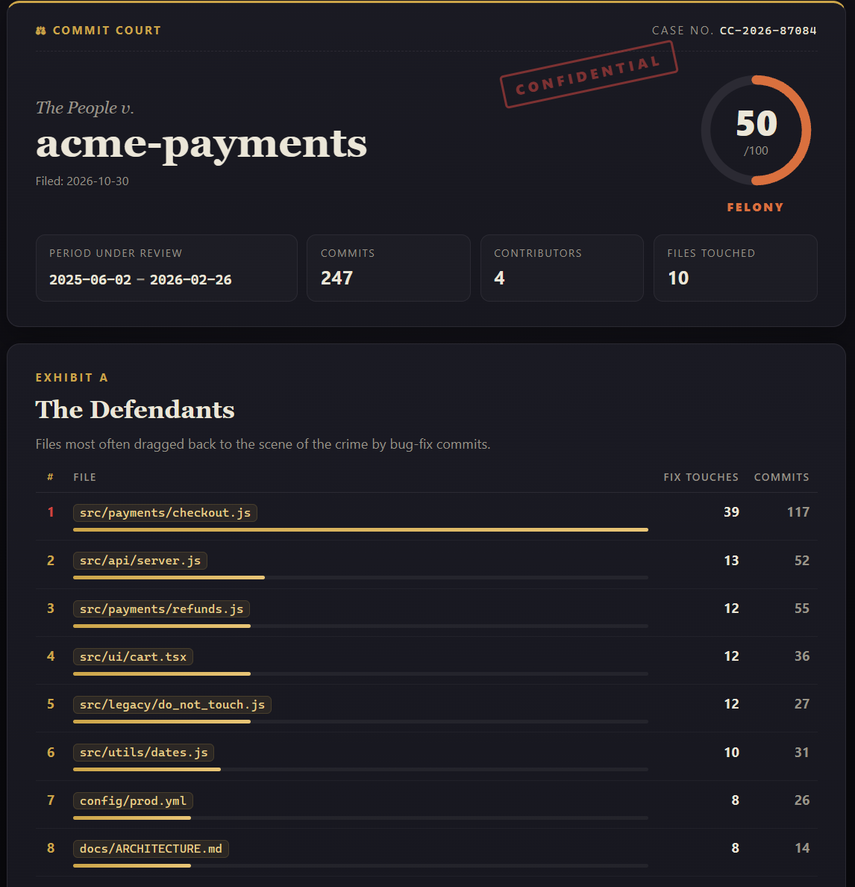

<div align="center">

# ⚖️ commit-court

**Put your git history on trial.**

One command turns any repository into a noir courtroom case file: the guilty files,
the repeat offenders, the 3 a.m. crimes, and a verdict with a sentence.

```bash
pipx install git+https://github.com/alibehnam14/commit-court.git
```

[English](README.md) · [فارسی](README.fa.md)

<!-- Replace with a real recording: docs/demo.gif -->


</div>

---

## Quick start

```bash
cd your-repo
commit-court .
```

That writes `commit-court-report.html` and opens it in your browser. One self-contained file, no
server, no CDN, no tracking. Screenshot it, share it, frame it.

<!-- Replace with a real screenshot of examples/sample-report.html: docs/screenshot.png -->


Want to see one first? Open [`examples/sample-report.html`](examples/sample-report.html)
([Persian version](examples/sample-report.fa.html)), generated from a fake repo with a gloriously
bad history.

## The case file

| Exhibit | What it shows |
|---|---|
| **Case header** | Repo name, period under review, commits, contributors, a (fake) case number |
| **The Defendants** | Top 10 files touched by bug-fix commits (`fix`, `bug`, `hotfix`, `patch`, `revert`, `oops`) |
| **Serial Offenders** | The worst commit messages: `fix`, `asdf`, `wip`, `final_final2`, `.`, one-word, ALL CAPS, too short, with counts, hashes and dates |
| **Time of Crime** | 24-hour and weekday bar charts, plus the peak hour for bad commits |
| **Repeat Offender Streaks** | Longest run of consecutive commit days, and the longest silence |
| **Churn Hotspots** | Files changed in the most commits |
| **The Verdict** | A 0-100 health score, a witty ruling and a sentence, plus a **Copy share text** button |

## Features

- **Zero dependencies.** Pure Python 3.9+ standard library; it just calls `git log`.
- **Fast on huge repos.** Streams `git log` and keeps only aggregates in memory.
- **Offline by default.** The report has a strict Content-Security-Policy; it cannot make a network request.
- **Safe.** Every commit message, author name and file path is HTML-escaped.
- **Bilingual.** `--lang fa` renders the entire report and every verdict in Persian, right-to-left.
- **Optional AI judge.** `--ai` asks Claude for a custom verdict. Off by default.
- **Deterministic.** 14 built-in rulings per language, picked from your stats, so the same repo gets the same verdict.

## Usage

```text
commit-court [path] [--out FILE] [--since DATE] [--author NAME] [--lang en|fa]
             [--ai] [--no-ai] [--include-merges] [--no-open] [--version]
```

| Flag | Meaning |
|---|---|
| `path` | Repository to judge (default `.`) |
| `--out FILE` | Output file (default `commit-court-report.html`) |
| `--since DATE` | Only commits after `DATE`; anything `git log --since` accepts (`2025-01-01`, `"6 months ago"`) |
| `--author NAME` | Only commits whose author matches `NAME` |
| `--lang en\|fa` | Report language |
| `--ai` | Let Claude write the verdict (see [Privacy](#privacy)) |
| `--no-ai` | Force the built-in verdict, even if `--ai` is also given |
| `--include-merges` | Count merge commits too (excluded by default) |
| `--no-open` | Don't open the browser |

### Persian report

```bash
commit-court . --lang fa --out report.fa.html
```

The page is rendered with `dir="rtl"` and a Persian-capable system font stack (Vazirmatn, Vazir,
Segoe UI, Tahoma, Noto Sans Arabic…). Code, hashes, paths and numbers stay left-to-right and readable.

### AI verdict (optional)

```bash
pipx install "commit-court[ai] @ git+https://github.com/alibehnam14/commit-court.git"
export ANTHROPIC_API_KEY=sk-ant-...
commit-court . --ai
```

The model defaults to `claude-haiku-5-5` (small and fast). Override it with `COMMIT_COURT_MODEL`.
If the key is missing, the package isn't installed, the network is down or the API errors, you
still get a report with a built-in verdict. The AI path never makes the tool fail.

## Privacy

- commit-court runs entirely on your machine and **never uploads anything** by default.
- The AI verdict only runs when you pass `--ai` explicitly **and** `ANTHROPIC_API_KEY` is set.
- Before calling the API it prints exactly what will be sent:
  aggregated statistics (counts and ratios) and **at most 10 commit messages** (the worst offenders).
- It **never** sends source code, diffs, file paths, author names, emails or the repository name.
- The generated HTML contains no scripts from elsewhere, no fonts, no analytics, and a CSP of `default-src 'none'`.

## Score formula

The health score starts at 100 and loses points for four habits:

```
score = round(100 − 35·B − 25·F − 20·H − 20·L), clamped to 0..100
```

| Factor | Max penalty | Definition |
|---|---|---|
| **B** bad messages | 35 | `bad_commits / total_commits` |
| **F** fix ratio | 25 | `clamp((fix_commits / total − 0.15) / 0.50, 0, 1)`: up to 15% fixes is healthy, 65%+ costs everything |
| **H** hotspot concentration | 20 | Share of file changes landing in the busiest 10% of files (`k = ceil(n/10)`), normalised so uniform = 0 and "everything in one file" = 1: `clamp((share − k/n) / (1 − k/n), 0, 1)` |
| **L** late nights | 20 | `clamp((late_night_commits / total) / 0.30, 0, 1)`, late night = 23:00-04:59 in the author's own timezone |

A commit message is **bad** if it is empty, only punctuation, a keyboard mash (`asdf`, `aaaa`),
a `final_final2`, made only of lazy words (`fix`, `wip`, `update`, `stuff`…), ALL CAPS,
a single word, or shorter than 8 characters. A commit is a **fix** if its message matches
`\b(fix|bug|hotfix|patch|revert|oops)` (case-insensitive).

| Score | Grade |
|---|---|
| 90-100 | Acquitted |
| 75-89 | Probation |
| 55-74 | Misdemeanor |
| 35-54 | Felony |
| 0-34 | Life sentence |

The verdict text names the "crime" that cost the most points (or weekend work / long silences, if
those stand out).

## Contributing

Bug reports, new rulings (in any language!) and new exhibits are welcome. See
[CONTRIBUTING.md](CONTRIBUTING.md). The short version:

```bash
git clone https://github.com/alibehnam14/commit-court.git
cd commit-court
python -m venv .venv && . .venv/bin/activate   # Windows: .venv\Scripts\activate
pip install -e ".[dev]"
pytest
python scripts/make_demo_repo.py               # regenerate examples/
```

## License

[MIT](LICENSE) © 2026 Ali Behnam
